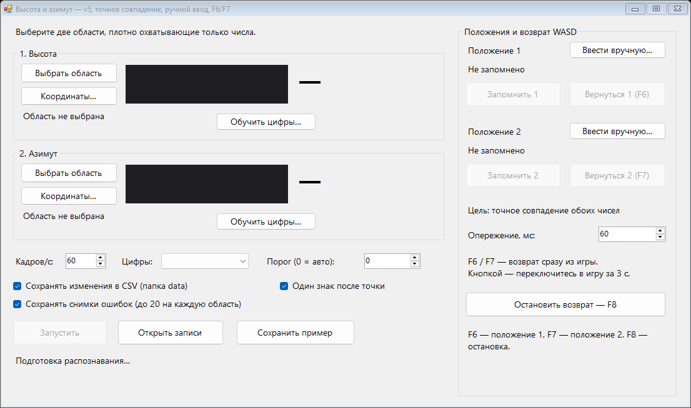

# AimHelper — наведение M777 (М777) в Arma Reforger

**AimHelper — помощник наведения гаубицы M777 (М777) для компьютерной игры Arma Reforger.** Программа для Windows считывает с экрана угол возвышения и азимут, запоминает два положения орудия и возвращает наведение к заданным углам одновременным удержанием WASD.

Проект создан, чтобы облегчить повторное наведение артиллерии M777 в Arma Reforger. Высоту и азимут можно задать вручную либо сохранить из текущих показаний игры. Во время возврата программа следит за обеими осями: если подъём или опускание меняет азимут, он также корректируется.

**M777 Arma Reforger aiming helper:** a Windows tool that reads elevation and azimuth from the screen, saves two howitzer positions, and returns to the selected angles using simultaneous WASD key holds. F6/F7 select a saved position; F8 stops movement. The user supplies the desired angles.

[Репозиторий AimHelper](https://github.com/sashaserm-arch/AimHelper) · [Готовые выпуски](https://github.com/sashaserm-arch/AimHelper/releases) · [Предложить улучшение](https://github.com/sashaserm-arch/AimHelper/issues)

Если готового выпуска в Releases ещё нет, приложение можно собрать из исходников по инструкции ниже. В исходниках и имени EXE сохранено техническое название `AngleReader`.

Текущая версия — **0.5.0**, соответствует пятой версии приложения.



## Возможности

- Выбор двух областей мышью или ввод координат вручную.
- Захват с целевой частотой 60 кадров/с и отображение фактической скорости.
- Локальное распознавание цифр, включая обучение на образцах.
- Два сохранённых положения: запоминание текущих показаний или ручной ввод.
- Одновременное удержание W/S и A/D с обратной связью по обоим углам.
- Коррекция ухода азимута при изменении высоты и обратного влияния осей.
- Точное совпадение обоих показаний в течение 0,4 секунды перед подтверждением цели.
- Журнал изменений CSV и сохранение примеров распознавания.

| Клавиша | Действие |
| --- | --- |
| F6 | Вернуться к положению 1 из окна игры |
| F7 | Вернуться к положению 2 из окна игры |
| F8 | Остановить возврат и отпустить удерживаемые программой клавиши |

## Требования

Windows 10/11 x64, .NET Framework 4.8. Python, модели OCR и доступ в интернет для работы приложения не требуются.

Для сборки через `build.cmd` достаточно компилятора из установленного .NET Framework. Для открытия `AngleReader.csproj` в Visual Studio потребуется поддержка разработки .NET Framework 4.8.

## Быстрая сборка

Из папки проекта в PowerShell или CMD:

```console
.\build.cmd
```

Готовая программа: `bin\Release\AngleReader.exe`. Запустите её двойным щелчком или из терминала:

```console
.\bin\Release\AngleReader.exe
```

## Как использовать AimHelper с M777 в Arma Reforger

1. Откройте управление M777 в Arma Reforger. Выберите область высоты и область азимута. В каждой должно быть только соответствующее число с небольшим отступом.
2. Нажмите **«Запустить»** и проверьте оба распознанных значения.
3. Укажите цели через **«Ввести вручную…»** или кнопки **«Запомнить 1/2»**.
4. Переключитесь в игру и нажмите **F6** или **F7**. Возврат начнётся сразу.
5. **F8** прекращает возврат. При использовании кнопки возврата в окне приложения даётся 3 секунды на переход в игру.

W поднимает, S опускает, A поворачивает влево, D вправо. Во время движения программа удерживает нужную пару клавиш, проверяя оба угла. При потере фокуса, пригодных показаний или остановке захвата клавиши отпускаются.

Подробности: [руководство пользователя](docs/USER_GUIDE.txt).

## Что означает точность

Программа проверяет **точное совпадение распознанных показаний**. Например, `28.0 / 255.2` не считается достижением цели `28.2 / 255.4`. Ввод рассчитан на десятые доли градуса; скрытый угол между отображаемыми делениями OCR не измеряет.

Достижение любой цели не гарантируется: оно зависит от шага управления игры, задержек, инерции и правильности OCR. При невозможности попасть точно программа прекращает возврат и сообщает об этом. Близкое положение не выдаётся за достигнутую цель.

Целевая частота захвата — 60 кадров/с; реальная частота видна внизу окна. Предпросмотр обновляется реже захвата. Значения, появившиеся между кадрами, могут быть пропущены.

## Проверки и упаковка

```console
.\test.cmd
.\package.cmd
```

`test.cmd` собирает приложение и запускает встроенные проверки **без отправки реальных нажатий**. Проверяются OCR, сохранение настроек, обе связанные оси, удержание клавиш, точное совпадение, отказ при недостижимой цели и прекращение при сбоях.

Отчёт: `test-output\self-test.txt`. В отчёте должно быть `Failures: 0`, команда завершается с кодом 0.

`package.cmd` выполняет сборку и тесты, затем создаёт:

```text
dist/AngleReader-v0.5.0-win-x64.zip
dist/AngleReader-v0.5.0-win-x64.zip.sha256
```

ZIP содержит только приложение, его конфигурацию и инструкции. Личные настройки и обученные образцы в него не включаются.

GitHub Actions настроен на сборку, тесты и подготовку ZIP при push и pull request. Сборку можно скачать из **Actions → нужный запуск → Artifacts**. Публикация в Releases выполняется отдельно.

## Структура

```text
src/                  Интерфейс, OCR и управление WASD
tests/                Симуляция наведения и проверки ввода
docs/                 Руководство и изображение интерфейса
.github/workflows/    Автоматическая сборка в Windows
build.cmd             Сборка без Visual Studio
test.cmd              Проверки без реального управления
package.cmd           Сборка, тесты и переносимый ZIP
AngleReader.csproj    Проект для Visual Studio / MSBuild
```

Приложение создаёт папку `data` **рядом со своим EXE**. В ней хранятся координаты областей, две цели, обученные цифры, журналы и примеры. Эта папка исключена из Git вместе с результатами сборки и тестов.

## Предложить изменения

Улучшения для наведения M777 в Arma Reforger можно предложить через [Pull request](https://github.com/sashaserm-arch/AimHelper/pulls). Опишите, что изменили и как проверили работу. Решение о включении правок в основную версию принимает владелец проекта.

Для сообщения об ошибке используйте [Issues](https://github.com/sashaserm-arch/AimHelper/issues). Приложите описание проблемы и, при необходимости, пример распознавания, сохранённый кнопкой «Сохранить пример».

## Разработка

Исходники и команды сборки находятся в этом репозитории. Предлагайте изменения через Pull request; решение о принятии правок остаётся за владельцем проекта.

Сборка и тесты проверены локально на Windows. Настройку GitHub Actions нужно проверить первым запуском после публикации. Управление конкретной игрой и глобальные горячие клавиши зависят от окружения пользователя.

Лицензия для распространения проекта пока не выбрана.
